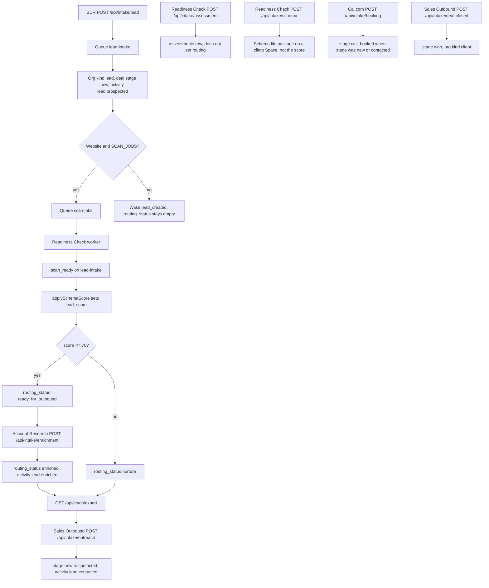

# Voice call center plan — Ada on Cloudflare

**Status:** Plan only. Nothing in this document is implemented.
**Date:** 2026-10-19
**Repo:** `makemoney2023/abracadabra` (HQ at `hq.abra-ca-dabra.app`, handoff worker at `handoff.abra-ca-dabra.app`)
**Companion draft (do not edit from this plan):** [salesenablement PR #1](https://github.com/makemoney2023/salesenablement/pull/1), head `cursor/abracadabra-pathway-draft-aee4`

This file is the overall plan Christopher Buzny asked to commit. It does not change app code, config, migrations, secrets, or Wrangler settings. It does not call Bland, Cal.com, or any external write API. No agent sends email, places a call, or contacts a prospect unless Christopher explicitly approves that action. Christopher approves each merge, each production deploy, any live Bland publish, and any live call.

No SuperPatch name, voice, pathway id, knowledge-base id, tool id, or calendar appears on anything live for Abracadabra.

## 1. Goal

Ada is Abracadabra's outbound voice agent on Bland.ai. She calls small-business owners from HQ leads and books a discovery / thirty-minute working session with Christopher Buzny. Inbound comes later, after outbound is accepted.

Houdini (`houdini@abra-ca-dabra.app`) handles written and email follow-up only. Ada does not tell the prospect they will meet Houdini.

## 2. Everything runs on Cloudflare

The call center in [salesenablement](https://github.com/makemoney2023/salesenablement) today is a Next.js app in `superpatch-frontend/` plus Supabase Postgres (project `gdwwppwaxyvudsecexuq`) and Edge Functions. That host is the thing to leave. The target is the existing HQ Cloudflare account (`6f6959ecba86d1de4d6cf6aa0b34528d`):

| Piece | Cloudflare home |
|---|---|
| Dialer and retry | New Cron Triggers on worker `handoff`. The crons already in `handoff/wrangler.jsonc` (`* * * * *`, `0 * * * *`, `0 8 * * 1`) wake the HQ agent. They are not a dialer. Do not reuse them as one. |
| Bland webhooks | New route on worker `handoff` (proposed `POST /api/bland/webhook`). No such route exists. |
| Call records | D1. Prefer the existing database `handoff` (`b2be192c-db0d-447f-8d7c-b2c4d39df274`, binding `DB`) so leads and calls share one record. A separate D1 is an open question if call volume should be isolated. |
| Burst work (webhook fan-out, analysis) | A new queue, not `lead-intake`. `lead-intake` already accepts CRM intakes and retries to `lead-intake-dlq`. Mixing dial jobs into that consumer would couple a failed call to lead intake. |
| Operator UI | Staff UI on worker `handoff-hq` (`hq.abra-ca-dabra.app`), later. No Vercel app. |

Workers Builds for `handoff`, `handoff-hq`, and `handoff-agent` trigger on every push to `main` (`path_includes: ["*"]`, `path_excludes: []`). A docs-only merge to `main` still deploys those workers. This plan stays on a branch until those path filters exclude `docs/` (see the PR). Do not add a cron, a queue, or a route in this change.

### Mapping from salesenablement to Cloudflare

Grounded in `salesenablement` `ARCHITECTURE.md`, `supabase/functions/`, and `canonical_ids.json` (default branch at the time of this plan, commit `6363309166a4c83525b1df71236c890916ab1714`). `batch-caller` is **not** in `supabase/functions/`. The dialer described there is `process-retry-queue` (pg_cron, `America/Toronto` weekdays 09:00–17:00, `do_not_call = false`, `next_retry_at`) plus a manual single-call route from `/campaign`. Exact retry counts were not read from `process-retry-queue/index.ts`; do not invent them (open question).

| Current piece | What it does today | Cloudflare home |
|---|---|---|
| `superpatch-frontend/` Next.js (`/campaign`, `/reports`) | Operator UI. Architecture doc says Vercel. | New HQ pages on `handoff-hq`, after Christopher approves the UI. |
| Supabase `practitioners`, `call_records` | People and call rows. | New D1 tables on `handoff`. Names are not invented here; they do not exist yet. |
| `sample_requests`, `send-sample-confirmation` (Resend) | SuperPatch sample kits. | Do not port. |
| `process-retry-queue` + pg_cron | Dialer and retry. Toronto business hours only. | Cron on `handoff`, per-lead local hours (section 4). |
| Manual `/campaign` call route | One call by hand. | HQ action, still behind Christopher's approval. Not a live button in this plan. |
| `webhook-processor` | Bland webhook. `deriveCallStatus`: an `appointment_time` alone is not a booked demo. | `POST /api/bland/webhook` on `handoff`, then the signed call-outcome intake. |
| `book-appointment`, `sync-cal-bookings` | Post-call Cal.com booking and backfill. | Worker logic after the webhook. Cal.com event slug for Christopher is a placeholder. Do not call Cal.com from this plan. |
| `analyze-call` | Writes Gemini `analysis_json`. | Later. Worker `handoff` already has an `AI` binding; whether call analysis uses it is open. Do not send call audio anywhere in this plan. |
| `generate-daily-report` | `/reports`. | Later cron plus an HQ page. |
| `enrich-practitioners-v2` | Practitioner enrichment in Supabase. | Not HQ enrichment. HQ enrichment is `POST /api/intake/enrichment` from Account Research. |
| Bland custom tools `check_availability` / `book_appointment` | Point at Cal.com for SuperPatch (`canonical_ids.json`: event slug `30min`, event type `4352394`, username `superpatchhealthprosales`). | New tool ids. Placeholders in PR #1: `TODO_CHRISTOPHER_CHECK_AVAILABILITY_TOOL_ID`, `TODO_CHRISTOPHER_BOOK_APPOINTMENT_TOOL_ID`. Do not reuse `TL-79a3c232-ca51-4244-b5d2-21f4e70fd872` or `TL-bbaa7f38-1b6a-4f27-ad27-18fb7c6e1526`. |
| `canonical_ids.json` live pathways and KB | Six practitioner pathways, KB `b671527d-0c2d-4a21-9586-033dad3b0255`, voice `78c8543e-e5fe-448e-8292-20a7b8c45247` ("Jennifer"). | Leave in place until Abracadabra outbound and inbound are live. Then retire. Do not copy these ids into HQ. |
| Flask `appointment_webhook/server.py` | Companion, not the production webhook. | Do not port. |

## 3. HQ changes (proposed, not built)

### Export

`GET /api/leads/export` (`handoff/src/app/api/leads/export/route.ts`) is read-only. Auth is `Authorization: Bearer` matched to `LEAD_EXPORT_TOKEN`. Query `status` defaults to `ready_for_outbound`. `since` is an ISO date. Allowed statuses are `ready_for_outbound`, `enriched`, `nurture`, `scoring_error`, and `won` (`routingStatusOf` in `handoff/src/lib/lead-routing.ts`). Anything else returns 400: `status must be ready_for_outbound, enriched, nurture, scoring_error, or won.`

`ExportedLead.primary_contact` is `{name, email, title}`. `contacts[]` is `{name, email, is_primary}`. There is no phone, no `opted_in`, no `opted_out`, and no timezone. `industry` and `location` come from the latest `lead.prospected` activity JSON (`bdr.industry`, `bdr.location`), not from columns. `schema_score` is an alias of `deals.lead_score`.

Proposed response additions, once the columns or derivations exist:

- `primary_contact.phone` and `contacts[].phone` from `contacts.phone` (migration `0005_crm.sql`).
- `contacts[].opted_out` and `contacts[].opted_in` from `0017_contact_opt_out.sql` and `0005`.
- `timezone` — **no column and no export field exist.** Derivation is an open question (section 9). Do not invent a stored value.

`call_ready` must be added to `RoutingStatus`, `ROUTING_LABEL`, `routingStatusOf`, and the export allow-list, or `?status=call_ready` will 400. `deals.routing_status` is unconstrained `TEXT` (`0024_lead_scores.sql`), so a CHECK migration is not required for the string to be stored. The HQ leads board filter (`handoff/src/app/leads/view.ts`) is a later touchpoint, not part of this document's change.

### `call_ready`

New `routing_status` value. A deal is `call_ready` only when all of these are true:

1. Account Research has enriched it (`routing_status` is `enriched` today; see section A for how that flip works).
2. A callable phone is on the contact.
3. `contacts.opted_out` is `0`.
4. The Canadian National DNCL / CRTC check and the US TCPA/DNC check for that number have passed and been logged.

`ready_for_outbound` stays the score gate (schema score ≤ 70). It is not "ready to dial." `call_ready` is the dial gate, after enrichment and compliance.

### Call outcome intake

Proposed `POST /api/intake/call-outcome`. It does not exist. Same HMAC as the other intakes (`handoff/src/lib/intake/sign.ts`): hex HMAC-SHA256 of the raw body in `x-intake-signature`, unix milliseconds in `x-intake-timestamp`, rejected at 401 when the signature is bad or the timestamp is more than 5 minutes off (`FIVE_MINUTES`). Body failure is 400. Missing `LEAD_INTAKE` queue is 503. Success is 202 `{ok: true}` after `queue.send({source, payload})`.

Proposed secret name, not present in `accept.ts` today: **`CALL_OUTCOME_SIGNING_SECRET`**. Own key, same pattern as `LEAD_AGENT_SIGNING_SECRET`, `ENRICHMENT_SIGNING_SECRET`, and `OUTREACH_SIGNING_SECRET`, so Voice can be revoked without rotating Sales Outbound. `acceptIntake`'s source union would gain `"call_outcome"`. The queue consumer in `handoff/src/lib/intake/queue.ts` would need the same source or the message is acked and dropped.

Outcome mapping (proposed consumer, not implemented):

| Outcome | What exists today | Proposed write |
|---|---|---|
| Booked with Christopher | Stage `call_booked` exists. `moveDealToCall` advances only `new` or `contacted`. `consumeBooking` inserts `appointments` with `provider` hard-coded `'calcom'`. | Set stage `call_booked`. Store the start on `deals.next_step_at` (unix ms, column exists) and an appointment. A new `provider` value vs reusing `calcom` is an open question. Do not add a column in this plan. |
| Callback | `deals.next_step` and `deals.next_step_at` exist. No call-outcome activity kind exists. | Log the time on `next_step` / `next_step_at` and a new activity kind (proposed `lead.call_outcome`). |
| Not interested | Stage `lost` and `lost_reason` exist. `nurture` is a `routing_status`, not a stage. No intake sets `lost`. `consumeDealClosed` refuses stage `lost`. | Christopher chooses `lost` or `nurture` per call. Do not pretend an intake already does this. |
| Send info / follow-up | `consumeOutreach` accepts `channel` `email` or `linkedin` only. It logs `lead.contacted` as actor `sales-outbound` and moves stage `new` → `contacted` only. It does not create a Houdini task. | Flag Houdini with a new activity. Sales Outbound / Houdini writes the email later, after Christopher approves that send. The dialer must not use the `EMAIL` binding. |

## 4. Dialer flow

1. Poll `GET /api/leads/export?status=call_ready` with `LEAD_EXPORT_TOKEN`.
2. Place the Bland call only inside that lead's local business hours. Timezone is not on the export today, so this step cannot run until section 9 is answered.
3. Use the Ada pathway from salesenablement PR #1 after Christopher approves a live Bland publish. Pass per-call context as `request_data` (section B). Attach the Abracadabra knowledge base at call time. Do not attach the SuperPatch KB.
4. Post the outcome to `POST /api/intake/call-outcome`.
5. Retry from `call_records` (new), not by leaving the deal in `call_ready` forever. Copy the *shape* of `process-retry-queue` (`next_retry_at`, a max-attempt cap, stop on `opted_out` / DNC / not interested / booked). Do not copy Toronto-only 09:00–17:00. The numeric cap is an open question until that function is read and Christopher sets Abracadabra's policy.

## 5. Compliance gate (required before any live dial)

Before every attempt:

- Canadian National Do Not Call List and CRTC Unsolicited Telecommunications Rules when the number is Canadian.
- US TCPA and National DNC when the number is American.
- Honour `contacts.opted_out = 1`. That flag today means the contact asked **this mailbox** to stop (`0017` comment: "opted_in stays unused"; set in `client-channel-store.ts` by lower-cased email). It is not a phone DNC flag. The dialer still treats it as do-not-call.
- `opted_in` defaults to `0` and is unused. Requiring `opted_in = 1` would block every current contact. Whether consent must be affirmative is an open compliance question for Christopher, not a default this plan turns on.
- Log the clock time, the lead timezone used, and the rule that allowed or blocked the attempt.

There is no DNC table in HQ. `process-retry-queue`'s `do_not_call` boolean and Toronto window are not this gate.

## 6. Pathways

salesenablement PR #1 keeps the sales-framework graph and rewrites content only. Source: `Chiropractors_contextual.json`. Draft: `b2b_sales_enablement/bland_ai_pathways/abracadabra/Abracadabra_SMB_Outbound.json`. 41 nodes, 410 edges, same node ids, types, and edge endpoints. Persona Ada. The working session is with Christopher Buzny. The draft is not published and does not change `canonical_ids.json`.

Order:

1. Finish Abracadabra outbound (placeholders in that README, plus the `{{variable}}` follow-up in section B).
2. Publish only after Christopher approves.
3. Retire the six live SuperPatch pathways only after Abracadabra outbound and inbound are in production.
4. Add an inbound pathway after outbound is accepted. It is not in that PR.

## 7. Phased rollout

| Phase | Work | Gate |
|---|---|---|
| 0 | This plan on a branch. | Christopher reviews. Do not merge to `main` while Workers Builds deploy every `main` push. |
| 1 | Export phone, opt-out, and timezone. Define `call_ready`. No dialer. | Christopher approves the merge and the production deploy. |
| 2 | Signed `POST /api/intake/call-outcome` writing stages and activities. Still no Bland calls. | Christopher approves merge and deploy. |
| 3 | D1 call tables, cron, webhook route, queue. Dry-run against fake numbers. | Christopher approves merge and deploy. |
| 4 | Ada pathway and KB uploaded in Bland. One supervised test call Christopher places or approves. | Christopher approves the live Bland publish and that call. |
| 5 | Compliance vendor or manual DNCL/DNC check logged on every attempt. | Required before any other live dial. |
| 6 | Retire SuperPatch pathways. Then inbound. | Christopher approves each unpublish and the inbound publish. |

Agents never send email, place calls, or contact prospects without his explicit approval for that action.

## 8. Owners

| Area | Owner |
|---|---|
| Pathways, Bland tools, call center worker | Voice |
| HQ export, routing, intake, D1 | Abra-ca-dabra (HQ) |
| Written follow-up | Sales Outbound / Houdini (`houdini@abra-ca-dabra.app`) |
| `POST /api/intake/lead` | BDR |
| `POST /api/intake/enrichment` | Account Research |
| Schema scan score | System actor `schema` (Readiness Check worker consumes `scan-jobs`; HQ applies the score) |

## 9. Open questions

| Placeholder | Why it is open |
|---|---|
| Bland voice id | PR #1: `TODO_CHRISTOPHER_BLAND_VOICE_ID`. Do not reuse Jennifer `78c8543e-e5fe-448e-8292-20a7b8c45247`. |
| Bland KB id | PR #1: `TODO_CHRISTOPHER_ABRACADABRA_KB_ID`. Do not reuse `b671527d-0c2d-4a21-9586-033dad3b0255`. |
| Cal.com event slug for Christopher | PR #1: `TODO_CHRISTOPHER_CAL_EVENT_SLUG`. SuperPatch slug `30min` / event `4352394` stays theirs. |
| Transfer phone | PR #1: `TODO_CHRISTOPHER_TRANSFER_PHONE`. The public site has no phone; the draft does not transfer live. |
| Pricing | PR #1: `TODO_CHRISTOPHER_PRICING`. No public price page was found. Ada must not invent one. |
| D1 choice | Existing `handoff` database vs a new D1. Recommendation: existing `handoff` DB. Christopher decides. |
| Timezone source | Not stored. Candidates: BDR `location` string, schema-scan `openingHours`, phone area code. None is implemented. |
| Retry cap and backoff | Not copied from code in this plan. |
| `opted_in` as a call prerequisite | Column exists, default 0, documented unused. |
| Appointment `provider` for Ada bookings | Only `'calcom'` is written today. |
| `batch-caller` | Not in `supabase/functions/` at the skim. Treat `process-retry-queue` as the dialer until someone finds another entry point. |
| Call analysis model | Gemini today in salesenablement. Workers AI binding exists on `handoff` and is not wired to calls. |

## A. End-to-end HQ lead flow as it works today

A BDR lead does not become a phone call inside HQ. The pipeline stops at export. Voice is not a consumer yet.



Shared intake mechanics (`handoff/src/lib/intake/accept.ts`, `sign.ts`, `queue.ts`): the route checks the signature, checks the body, and sends `{source, payload}` to queue `lead-intake`. Worker `handoff` consumes it. A bad signature or a timestamp more than 5 minutes off is 401. A bad body is 400. No queue binding is 503. A good post is 202. A database throw retries; a payload the consumer rejects is acked and dropped. `handoff-hq` can enqueue and does not consume.

### 1. BDR intake

| | |
|---|---|
| Endpoint | `POST /api/intake/lead` |
| Secret | `LEAD_AGENT_SIGNING_SECRET` |
| Owner | BDR (`actor_id` `bdr`) |
| Required body | `external_id`, and `email` or `domain`. Optional `bdr_fit_score` must be an integer 1–5 or the body is rejected. |
| Writes | Organization `kind = 'lead'`. Contact via `insertContact` (name, email, `is_primary`; **phone column omitted**). Deal `stage = 'new'`, `source` from the body or `"bdr"`. Activity `lead.prospected` with `company`, `website`, `industry`, `location`, `contact_name`, `contact_title`, `fit_reasons`, `signals`, `source_urls`, `bdr_fit_score`. Receipt `source = 'lead'`. |
| Does not write | `contacts.phone`, `contacts.title` (title stays in the activity), `organizations.industry` (the column exists; the value stays in the activity), `routing_status`. |
| Next | If this insert created the org (`leadOrganizationId`) and `organizations.website` is set and `SCAN_JOBS` is bound, `startLeadSchemaScan` inserts `readiness_scans` (`source = 'public'`, `status = 'queued'`) and sends `{type: "scan", scanId}` to queue `scan-jobs`. No website, or no queue: the agent wakes with `lead_created` and the deal never gets a score. |

### 2. Schema check (the score)

Two different "schema" doors exist. Only one sets the routing cutoff.

**Score path (not an HTTP intake from BDR).** The Readiness Check worker consumes `scan-jobs`. On `complete` or `failed` it sends `{source: "scan_ready", organizationId, scanId, status}` (`readiness-check/src/lib/jobs/scan-ready.ts`). `handleLeadIntakeBatch` calls `applySchemaScore` (`handoff/src/lib/lead-routing.ts`) and `storeScanContext`, which calls `enrichLeadFromSchema`.

| | |
|---|---|
| Secret | None on `scan_ready`. It is an internal queue message, not `POST /api/intake/schema`. |
| Owner | System actor `schema` for the scan activity. Score write is system code, not an agent signature. |
| Writes | `deals.lead_score` = `readiness_scans.score_total`. `deals.scored_at` ISO time. `deals.routing_status` from the cutoff below. On `scan_ready`, `enrichLeadFromSchema` may fill blank org fields and **insert extra contacts** that include `phone` scraped from scan pages (`lead-enrich.ts`). It skips a scrape contact whose email is already on the org, so the BDR contact created without a phone is not updated. |
| Failure | Missing `readiness_scans` table: `recordScoringFailure` sets `routing_status = 'scoring_error'`, activity `lead.scoring_failed`, and the queue message is retried. A failed scan on a `source = 'bdr'` open deal also records `scoring_error`. |

**Cutoff direction (checked in code, including tests).** `LEAD_READY_THRESHOLD` is `70`. `routingFor`:

- score **≤ 70** → `ready_for_outbound`
- score **> 70** → `nurture`

`70` itself is `ready_for_outbound` (`lead-intake.test.ts`). The comment in `lead-routing.ts` states the meaning: a **low** schema score means the site needs Abracadabra's work, so it is ready for outbound (Account Research enriches, then Sales Outbound). A **high** score is nurture, shown on the board as "C quality". This is the opposite of reading `lead_score` as "higher is a better lead." `bdr_fit_score` (1–5) does not affect this branch.

Rescore guard: if `routing_status` is already `enriched` and the new score would be `ready_for_outbound`, the status stays `enriched`. If the new score would be `nurture`, enriched is **replaced** with `nurture`.

**Package path (different endpoint).**

| | |
|---|---|
| Endpoint | `POST /api/intake/schema` |
| Secret | `INTAKE_SIGNING_SECRET` (the Readiness Check key, shared with assessment and booking) |
| Owner | Readiness Check site, not BDR and not Account Research |
| Required body | `scan_id`, `domain`, `files[]` with `path` and `content` (`schemaBodyReady`) |
| Writes | `fileSchemaPackage`: matches the domain to an organization or **inserts `kind = 'client'`**, ensures a Website project and a Space, files the package. Receipt `source = 'schema'`. |
| Does not write | `lead_score`, `routing_status`. The queue does not start `scan-jobs` for `source === "schema"`. |

### 3. Account Research enrichment

| | |
|---|---|
| Endpoint | `POST /api/intake/enrichment` |
| Secret | `ENRICHMENT_SIGNING_SECRET` |
| Owner | Account Research (`actor_id` `account-research`) |
| Required body | `external_id`, and `deal_id` or `domain` |
| Fields stored on activity `lead.enriched` | `brief`, `enriched_at`, and `ENRICHMENT_FIELDS`: `company_summary`, `decision_makers`, `pain_points`, `tech_stack`, `talking_points`, `sources`. Strings are sliced to 4000 characters. |
| Transition | Only when `routing_status === 'ready_for_outbound'`, set `enriched`. A deal that is still null, `nurture`, or `scoring_error` gets the activity and **does not** change status (`lead-intake.test.ts` covers nurture staying nurture). |

README (`handoff/README.md`) says Sales Outbound then pulls `GET /api/leads/export?status=enriched`. The route comment says the export is for Account Research. Both can call it; the token is one shared `LEAD_EXPORT_TOKEN`.

### 4. Assessment / Readiness Check survey

| | |
|---|---|
| Endpoint | `POST /api/intake/assessment` |
| Secret | `INTAKE_SIGNING_SECRET` |
| Owner | The person who finished the Readiness Check (system activity, not BDR) |
| Required body | `assessment_id`, and `email` or `domain` |
| Writes | `assessments` row: `answers_json`, `scores_json`, `total_score`, `utm_json`, `report_url`, `completed_at`. Activity kind `assessment`. May open a deal titled "… readiness check", `source = 'readiness_check'`, stage `new`, if none is open. |
| Does not write | `routing_status` or `lead_score`. README: "The Readiness Check survey does not set routing." |

`survey_url` on the export is **synthesized**, not stored. `surveyUrl` in `lead-export.ts` builds `{READINESS_CHECK_ORIGIN or CHECK_ORIGIN}/check?utm_source=outbound&utm_medium=email&utm_campaign=schema_score&utm_content=deal_<id>`. It is present even when no assessment exists. The returned assessment block (`readiness.total_score`, `scores_json`, `report_url`) is this survey, separate from `schema_score`.

`schema_report_url` is `{origin}/scan/{public_token}` of the latest complete `readiness_scans` row, or null.

### 5. Export

| | |
|---|---|
| Endpoint | `GET /api/leads/export?status=&since=` |
| Secret | `LEAD_EXPORT_TOKEN` (Bearer). Not an HMAC intake. |
| Owner | Caller is Account Research and/or Sales Outbound. HQ serves it. |
| Filter | Open deals (`stage` not `won` or `lost`) with that `routing_status`, newest `scored_at` first, limit 500. `status=won` matches `deals.stage = 'won'` and `since` filters `closed_at`. |
| Returned | Deal, org name/domain/website, `industry` and `location` from `lead.prospected`, primary contact name/email plus `contact_title` from that activity, `lead_score` and `schema_score` (same number), `schema_report_url`, `survey_url`, assessment block, full `bdr` object, full `enrichment` object, stage, `contacts[]` without phone, outreach activities, and on won deals `closing`. |

### 6. Outreach

| | |
|---|---|
| Endpoint | `POST /api/intake/outreach` |
| Secret | `OUTREACH_SIGNING_SECRET` |
| Owner | Sales Outbound (`actor_id` `sales-outbound`) |
| Required body | `external_id`, `deal_id` or `domain`, `channel` of `email` or `linkedin` |
| Optional | `sent_at`, `summary` |
| Writes | Activity `lead.contacted`. Stage `new` → `contacted` only. Other stages stay. |
| Does not write | A phone attempt, a Houdini task, or `call_booked`. |

### 7. Booking

| | |
|---|---|
| Endpoint | `POST /api/intake/booking` |
| Secret | `INTAKE_SIGNING_SECRET` |
| Owner | Cal.com webhook path (provider string `'calcom'`). Not Ada. |
| Required body | `external_id`, `starts_at` |
| Writes | `appointments` row (`provider = 'calcom'`, status from `kind`). Activity from `bookingBody` ("Booked a call." and the other status lines). If the deal stage is `new` or `contacted` and the booking is live, stage becomes `call_booked`. A missing deal is inserted as `call_booked` or `new` from that status, `source = 'calcom'`. |
| Gap | A deal already at `proposal`, `won`, or `lost` does not move. There is no Ada provider. |

### 8. Deal closed

| | |
|---|---|
| Endpoint | `POST /api/intake/deal-closed` |
| Secret | `OUTREACH_SIGNING_SECRET` (same key as outreach) |
| Queue source | `deal_closed` |
| Owner | Sales Outbound |
| Required body | `external_id`, and `deal_id` or `domain`. Optional `closed_at`, `value_cents`, `products` or `services`, `notes`. |
| Writes | Stage `won`, `closed_at`, `value_cents`, organization `kind = 'client'`, activity `deal.won`, and a project plus Space. |
| Refuses | Stage `lost`. Nothing in the intake union sets `lost`. |

### Gaps and bugs in today's flow

1. **`call_ready` cannot be reached.** The status is not in `RoutingStatus`. Export would 400.
2. **`ready_for_outbound` is removed by enrichment.** The dial list people might expect (`status=ready_for_outbound`) no longer contains researched leads. They are `enriched`. A future dialer that polls `ready_for_outbound` will skip the leads Account Research finished.
3. **Enrichment before the score does not stick.** If `routing_status` is still null, the enrichment activity is stored and the status is unchanged. The later score sets `ready_for_outbound` or `nurture`. The preserve-enriched CASE never sees `enriched`, so the lead looks unresearched unless Account Research posts again.
4. **Enrichment of a nurture lead does not mark it enriched.** The brief is saved; export `status=enriched` will not return it.
5. **A rescore to nurture clears `enriched`.** The CASE only preserves `enriched` when the new label would be `ready_for_outbound`.
6. **Phone is written in one place and dropped in two.** BDR insert does not set `contacts.phone`. Schema scrape can insert a phone on a *new* contact and skips the existing email. Export selects neither `phone` nor `opted_out`.
7. **`opted_out` is an email-mailbox stop**, not a phone opt-out. `opted_in` is unused and defaults to 0.
8. **No timezone** anywhere in the CRM schema. Local calling hours cannot be computed from stored data.
9. **Leads with no website never score**, so they never become `ready_for_outbound`.
10. **`POST /api/intake/schema` is not the schema score.** It files a client website package. Using it as the "schema check" in a voice runbook would open clients and would not set the cutoff.
11. **`survey_url` is always minted.** It does not mean the prospect took the survey. `readiness` is null until an assessment row exists.
12. **`organizations.industry` and `contacts.title` are not the BDR values.** Export reconstructs them from `lead.prospected`. A board that reads the columns will look blank.
13. **No intake sets stage `lost`.** "Not interested" has a column and no writer.
14. **`consumeOutreach` cannot represent a call** (`channel` is email or linkedin only) and does not flag Houdini.
15. **Internal queue messages with an unknown `source` are acked and dropped** (`messageShape` in `queue.ts`). A `call_outcome` source that is added on the route and not in this allow-list would return 202 and then disappear.

## B. Feeding HQ context into the call

### Where `call_ready` sits

`call_ready` is **after** `enriched`, not instead of the score cutoff and not instead of Account Research.

```text
BDR lead (stage new, no routing)
  → schema score
      ≤ 70 ready_for_outbound
      > 70 nurture          (not a dial candidate unless Christopher changes this later)
  → Account Research enrichment moves ready_for_outbound to enriched
  → phone present, opted_out = 0, DNCL/TCPA logged
  → call_ready
  → Ada dials
  → POST /api/intake/call-outcome
```

Do not dial `ready_for_outbound`. That status means "site needs work, not researched yet." Do not dial `nurture` under this plan. Do not dial a lead whose only phone was scraped onto a second contact unless that contact is the one being called and the DNC check ran on that number.

### Knowledge base vs this call

The Abracadabra knowledge base stays **generic**: what the studio does, published proof, what Ada must not invent (prices, the lunch offer, social-detail gaps). PR #1 says to attach that KB at call time.

**Per-lead facts go in Bland `request_data` on each `POST /v1/calls`**, which Bland exposes inside the pathway as variables. They are not written into the KB. A second lead must not inherit the first lead's summary.

### What the draft pathway already substitutes

Read from `Abracadabra_SMB_Outbound.json` on PR #1 (41 nodes). Mustache variables that actually appear:

| Variable | Nodes that use it today |
|---|---|
| `{{business_name}}` | 1 Introduction, 41 IVR Navigation |
| `{{business_city}}`, `{{business_region}}`, `{{business_address}}`, `{{business_languages}}`, `{{website}}`, `{{team_count}}`, `{{contact_email}}`, `{{google_rating}}`, `{{review_count}}` | 1 Introduction |
| `{{business_address}}`, `{{contact_email}}`, `{{to}}` | 27 Check Availability |
| `{{appointment_time}}`, `{{best_phone}}`, `{{business_address}}`, `{{contact_email}}`, `{{to}}` | 28 Schedule Appointment |
| `{{appointment_time}}`, `{{contact_email}}`, `{{owner_name}}` | 32 End Call: Follow-Up Scheduled |

`{{to}}` is the number Bland dialed, not an HQ column. `{{appointment_time}}` is filled during the call by the booking tool, not from HQ. `{{owner_name}}` should be Christopher Buzny for Abracadabra, not the prospect.

Nodes with **no** HQ variables in the prompt text today: 2 Company Introduction; 3–7 discovery ladder (Business Overview, Customer Types, Where Work Slows, Current Tools, Ideal Outcome); 8–12 presentation; 13–19 and 35–36 objections; 20–26 engagement and close; 29 Schedule Callback; 30–31 and 33–34 and 37 end-call / send-info; 38 Team Size Discovery; 39 Team Working Session; 40 Find Decision Maker.

The draft README's call-list fields match the Introduction set (`business_name`, `business_city`, `business_region`, `business_address`, `website`, `team_count`, `contact_email`, optional `google_rating` and `review_count`). It does not mention enrichment or the schema score.

### Variables to pass (proposed `request_data`)

HQ field → Bland variable → node that should use it. "Today" means the JSON already references it. "PR #1 follow-up" means the prompt does not reference it yet; that edit belongs in salesenablement, not this repo.

| Bland variable | HQ source today | Use in the call | Node |
|---|---|---|---|
| `business_name` | `organizations.name` (export `name`) | Confirm she reached the business. | 1 Introduction (today), 41 IVR (today), 2 Company Introduction (follow-up) |
| `contact_name` | `primary_contact.name` or `lead.prospected.contact_name` | Ask for that person. Do not invent a name when null. | 1 Introduction, 40 Find Decision Maker (follow-up). Not the same variable as `{{owner_name}}`. |
| `contact_title` | `lead.prospected.contact_title` (export `primary_contact.title`). Not `contacts.title`, which BDR does not set. | Gatekeeper and decision-maker routing. | 1 Introduction, 38 Team Size Discovery, 40 Find Decision Maker (follow-up) |
| `contact_email` | `primary_contact.email` | Read-back before the calendar tool. | 27 and 28 (today) |
| `to` / `best_phone` | The number actually dialed, after DNC. `best_phone` only if HQ has a published phone. | Booking read-back. | 27 and 28 (today). Never speak an empty phone. |
| `website` | `organizations.website` | She may name the site. | 1 (today), 2 Company Introduction (follow-up) |
| `industry` | `lead.prospected.industry` | One phrase in the company intro. | 2 Company Introduction (follow-up) |
| `business_city`, `business_region`, `business_address` | **Not columns.** Only the free-text `location` string on `lead.prospected`. | Introduction already expects city/region/address. Until those are split, pass `location` as `business_city` only when it is a single city, otherwise pass `location_note` and leave city/region/address empty. | 1 (today) |
| `team_count`, `business_languages`, `google_rating`, `review_count` | **Not in HQ export.** | Leave empty. Ada must not invent a rating or a headcount. | 1 (today) |
| `company_summary` | `enrichment.company_summary` | Two sentences at the start of the company story, then stop. | 2 Company Introduction (follow-up) |
| `pain_points` | `enrichment.pain_points` | Questions, not a speech. She asks; she does not recite the list. | 5 Discovery: Where Work Slows (follow-up) |
| `tech_stack` | `enrichment.tech_stack` | What they already use, so "Already Have Someone" stays specific. | 6 Discovery: Current Tools, 15 Objection: Already Have Someone (follow-up) |
| `talking_points` | `enrichment.talking_points` | At most three short lines for the one service she presents. | 8–12 presentation nodes (follow-up). Not during discovery. |
| `decision_makers` | `enrichment.decision_makers` | Who can say yes. | 38 Team Size Discovery, 40 Find Decision Maker (follow-up) |
| `fit_reasons` | `bdr.fit_reasons` | Internal aim for the opener. Paraphrase one public reason. | 1 Introduction, 2 Company Introduction (follow-up) |
| `signals` | `bdr.signals` | Same rule. A signal like "no schema" becomes a question, not a score. | 5 Discovery: Where Work Slows (follow-up) |
| `schema_public_finding` | **Does not exist.** Derive one sentence from the scan report later. Do not pass `lead_score` / `schema_score`. | Plain language only ("the site doesn't tell search engines what you do"). | 8 Present: Search and AI Visibility, 13 Objection: Need Proof (follow-up) |
| `schema_report_url` | Export `schema_report_url` | She may offer to send the link. She does not read the URL character by character unless asked. Sending is Houdini's job. | 26 Offer Readiness Check, 37 Send Info Only (follow-up) |
| `survey_url` | Export `survey_url` | Offer the Readiness Check as the smaller step. Same send rule. | 26 Offer Readiness Check (follow-up) |
| `readiness_summary` | **Does not exist.** `readiness.total_score` and `scores_json` are internal. | One sentence only if an assessment exists. Never the numeric survey score. | 26 Offer Readiness Check (follow-up) |
| `owner_name` | Constant `Christopher Buzny` for this campaign. Not an HQ lead field. | The person on the booked session. | 32 (today), 24 Close, 30 End Call: Session Locked (follow-up; those prompts already say his name in prose) |

`bdr_fit_score`, `routing_status`, `lead_score`, `schema_score`, `nurture` / "C quality", `organizations.notes`, `lost_reason`, enrichment `sources`, and staff-only activity bodies are **not** `request_data` fields.

### Rules

- **Missing data.** Omit the key or pass `""`. Pathway text must treat empty as unknown. Node 28 already says not to speak a missing value. The same rule applies to every new variable. No "your score is", no "blank", no placeholder token.
- **Short.** `company_summary` capped at two sentences in the payload builder even though HQ stores up to 4000 characters. `talking_points` capped at three items. `pain_points` capped at three. Drop `sources`, raw HTML, and scan evidence JSON.
- **Never read internal notes or scores aloud.** The prospect does not hear 42, 70, "ready for outbound", "C quality", fit score 4, or a staff note. Public wording is a finding or a question.
- **One service.** `talking_points` may bias nodes 8–12. Discovery nodes 3–7 still do not present.
- **KB stays generic.** If a fact is true of this lead only, it belongs in `request_data`. If it is true of every Abracadabra call, it belongs in the KB draft.

### Example `request_data` (fake)

Not a real lead. Not a number to dial.

```json
{
  "business_name": "Northwind Bakery",
  "contact_name": "Ada North",
  "contact_title": "Owner",
  "contact_email": "ada.north@example.com",
  "to": "+15555550123",
  "best_phone": "+15555550123",
  "website": "https://northwind.example",
  "industry": "Bakery",
  "business_city": "Ottawa",
  "business_region": "",
  "business_address": "",
  "business_languages": "",
  "team_count": "",
  "google_rating": "",
  "review_count": "",
  "location_note": "Ottawa",
  "company_summary": "Northwind Bakery sells bread and cakes from one shop and takes orders on its site.",
  "pain_points": ["The site does not explain custom cakes", "Orders still arrive by phone"],
  "tech_stack": ["Squarespace"],
  "talking_points": ["Search and AI visibility for the cake menu"],
  "decision_makers": ["Ada North, owner"],
  "fit_reasons": ["Local shop with a thin site"],
  "signals": ["No schema on the menu"],
  "schema_public_finding": "The menu pages do not tell search engines what is for sale.",
  "schema_report_url": "https://check.abra-ca-dabra.app/scan/exampletoken",
  "survey_url": "https://check.abra-ca-dabra.app/check?utm_source=outbound&utm_medium=email&utm_campaign=schema_score&utm_content=deal_example",
  "readiness_summary": "",
  "owner_name": "Christopher Buzny"
}
```

Absent on purpose: `schema_score`, `lead_score`, `bdr_fit_score`, `routing_status`, `sources`, `notes`.

### Follow-up in salesenablement PR #1

Do not edit that repo from this plan. When Voice next touches the draft:

1. Add the follow-up variables above to the named nodes, as `{{company_summary}}`, `{{pain_points}}`, and the rest, with an empty-string instruction on each node.
2. Keep every node and edge. Content and variable references only.
3. Point Introduction's city/region/address at real HQ fields only after HQ can supply them. Until then the prompts must survive empty strings.
4. Do not put `schema_score` or `bdr_fit_score` in any prompt.
5. Re-run `test_abracadabra_pathway_schema.py` so the graph check still passes.

## C. Inbound web leads get a reply from Sales Outbound (approved Oct 19, 2026)

Christopher's decision on Oct 19, 2026: Sales Outbound (Houdini, houdini@abra-ca-dabra.app) replies to every Readiness Check submission and every start-a-project form submission, and **may send those replies automatically** without per-message approval. All other outreach stays approval-gated. Existing clients still go to Client Services (magic@).

### Today (verified Oct 19, 2026)

- **Readiness Check** (check.abra-ca-dabra.app): signed `POST /api/intake/assessment` creates an `assessments` row and may open a deal with `source = 'readiness_check'`, stage `new`. It sets no `routing_status` or `scored_at`, so `GET /api/leads/export` never returns it and no routine hands it to Sales Outbound. **Nobody replies.**
- **Start a project** (abra-ca-dabra.app/start/): `worker/intake.js` handles `POST /api/intake` and only emails houdini@ through Resend (`RESEND_API_KEY`, `INTAKE_FROM`, `INTAKE_TO`). Nothing reaches HQ. The `abracadabra-marketing` worker has no secrets set, so the email step likely fails and visitors see "Not sent" (to confirm). Sales Outbound reads houdini@ only once a day.

### Proposed (in progress, PR pending; not merged or deployed)

1. New `routing_status = reply_needed`, set by HQ when a Readiness Check or start-form submission opens or attaches to an open deal with an email contact. `scored_at` is stamped so `since` works. It does not overwrite BDR deals already in `ready_for_outbound` or `enriched`.
2. Start form posts a signed intake to HQ (HMAC `x-intake-signature` / `x-intake-timestamp`, the same scheme as the other intakes) and creates a deal with `source = 'start_form'`, storing need, budget, timeline, message, and company. The houdini@ email stays an optional extra. The visitor sees the thanks page once HQ accepts.
3. `GET /api/leads/export?status=reply_needed&since=` (Bearer `LEAD_EXPORT_TOKEN`) returns these leads with `source`, contact name/email, readiness score and `report_url`, or the inquiry fields.
4. A routine owned by Abra-ca-dabra polls that export and hands each new lead to Sales Outbound. Sales Outbound replies in Christopher's voice from houdini@ (Readiness Check: score, report link, and the discovery-call ask; start form: answer the brief and book discovery). It then posts `POST /api/intake/outreach` so the deal moves `new` to `contacted` and leaves the queue.
5. Guardrails on auto-replies: one reply per lead, no invented prices, timelines, or results, existing clients routed to magic@, honor `opted_out`, and the honeypot and rate limits stay in place.

### Relation to the voice plan

`reply_needed` leads are email-first. They are candidates for `call_ready` only after the phone, consent, and timezone work in sections 3 and 5 is approved and built.

## What this plan does not do

- No migration, no Wrangler edit, no secret, no route, no cron.
- No Bland publish, no Cal.com write, no email, no live call.
- No SuperPatch id copied into HQ.
- No change to salesenablement.
